# Protótipos de Interface por Perfil de Usuário

> **Projeto:** Portal Web da Comissão Própria de Avaliação (CPA) — Faculdade Impacta
> **Etapa:** Fase 2 — Modelagem e Design
> **Formato:** Protótipos navegáveis em HTML5 e CSS3 (templates Jinja2 do Flask)

| Integrante | Nome | RA |
|---|---|---|
| 1 | Monique Lima | 2503159 |
| 2 | Vitor Gabriel Ribeiro dos Santos | 2501307 |
| 3 | Alicya Sayuri Gallano Azato | 2500140 |

---

## 1. Abordagem de prototipação

Para acelerar a validação visual e garantir fidelidade técnica, a equipe desenvolveu os protótipos **navegáveis diretamente em HTML5 e CSS3**. Assim foi possível testar o fluxo de navegação, a hierarquia das informações e o comportamento responsivo antes da integração com o banco de dados.

Os protótipos evoluíram para as telas definitivas do portal: todas as páginas usam um layout comum (`templates/_layout.html`) e um único arquivo de estilos (`static/css/base.css`), o que mantém a identidade visual igual em todos os perfis.

> As capturas abaixo são do portal em funcionamento. Os dashboards aparecem com o aviso do Google porque o banco ainda usa **links de demonstração**; quando a CPA enviar os endereços oficiais, o admin troca os links pelo próprio portal.

---

## 2. Interfaces por perfil de acesso

### Perfil 1 — Visitante (área pública, sem login)

| Página | Rota | Conteúdo |
|---|---|---|
| **Início** | `/` | Apresentação da CPA, indicadores de transparência, atalhos para o mural, os relatórios, o contato e a área restrita. |
| **Mural de devolutivas** | `/devolutivas` | Cards em ordem cronológica com a demanda apontada, a área responsável, a ação da instituição e uma etiqueta de status (*Planejado*, *Em andamento*, *Concluído*), com filtro por status. |
| **Relatórios e boletins** | `/relatorios` | Repositório público com filtro por categoria e ano de referência e botão para abrir o PDF. |
| **Contato** | `/contato` | Canais de atendimento da CPA com botões diretos para Google Chat, Google Meet e e-mail. |

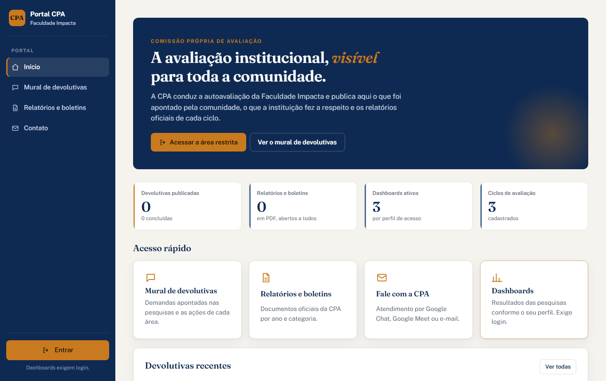

| Mural de devolutivas | Relatórios e boletins |
|---|---|
| 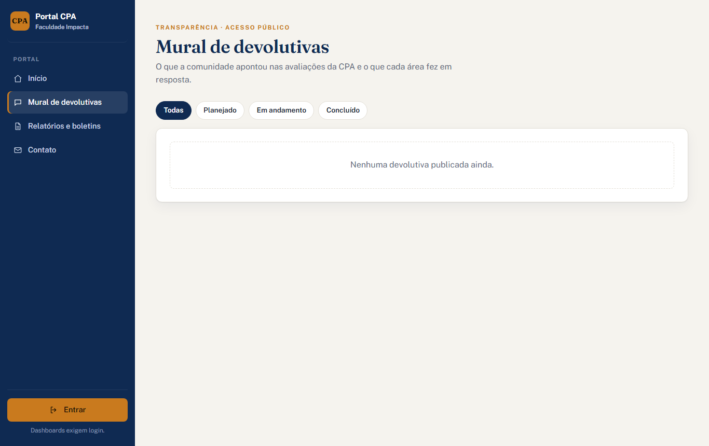 | 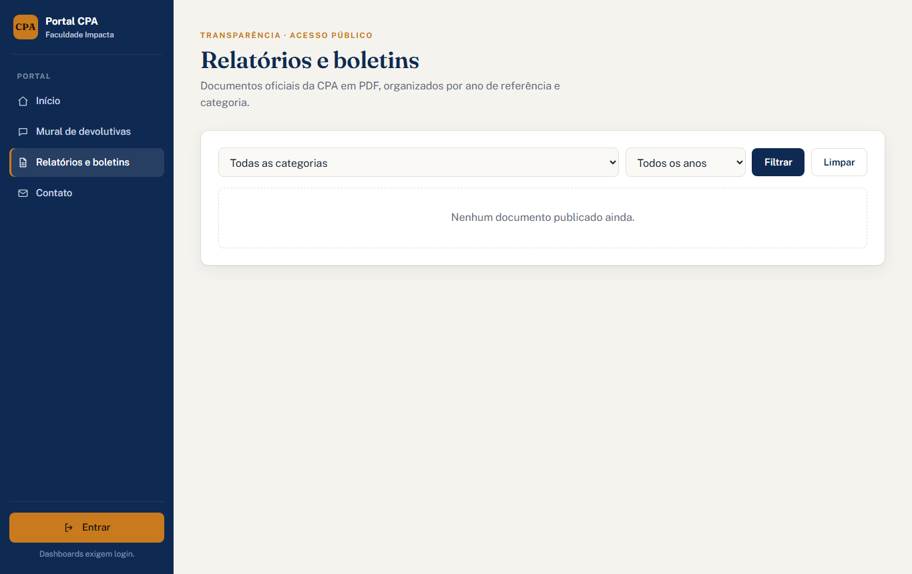 |

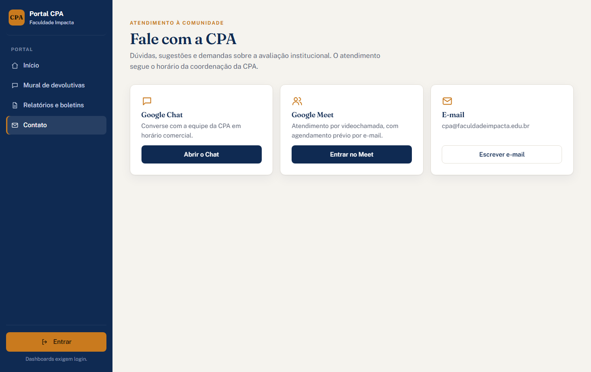

### Tela de autenticação (`/login`)

Formulário com e-mail institucional e senha. Em caso de credenciais inválidas, exibe um alerta claro; após o login, leva o usuário à área de dashboards com o conteúdo do seu perfil.

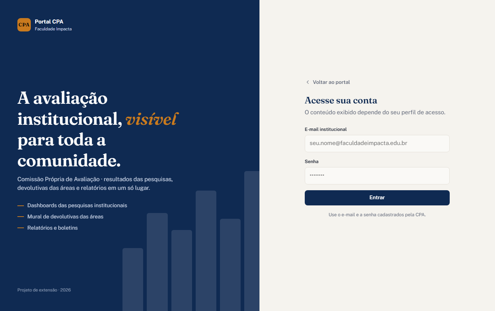

### Perfil 2 — Aluno (presencial e EAD)

Após o login, o menu identifica o usuário como **Aluno** e a página de dashboards (`/dashboards`) carrega somente o painel da **Pesquisa Institucional da CPA**. O aluno também consulta os ciclos de avaliação em **Minhas avaliações**.

| Computador | Celular |
|---|---|
| 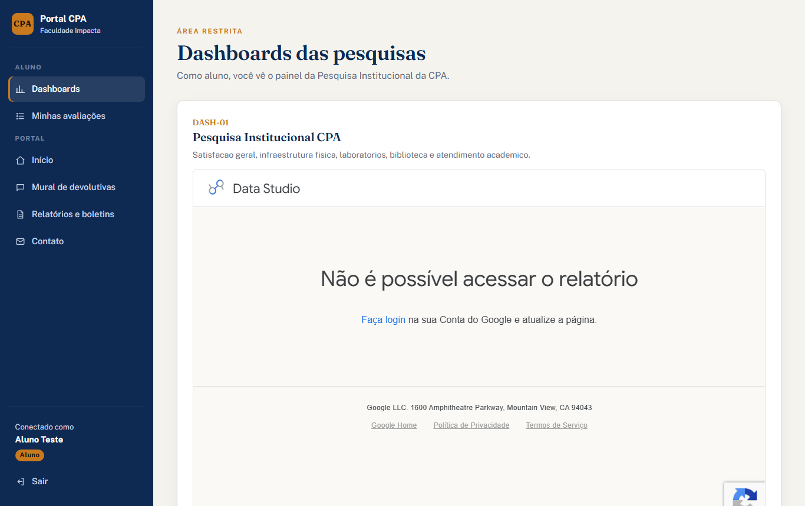 | 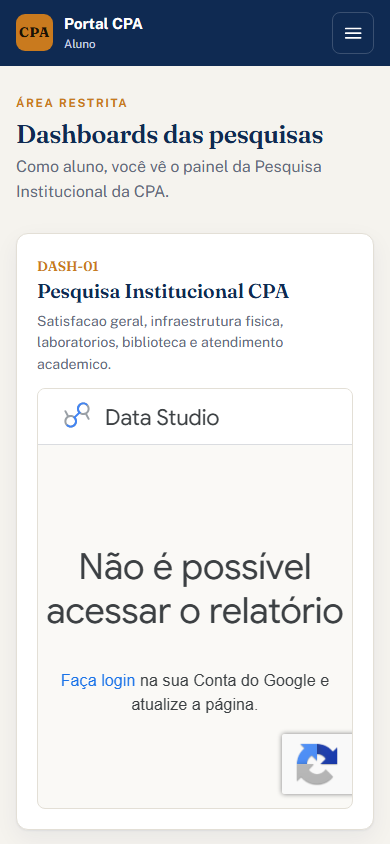 |

### Perfil 3 — Coordenador de curso

Além da Pesquisa Institucional da CPA, vê os painéis de **Avaliação Docente por Curso** e **Acompanhamento de Egressos**, para análise comparativa dos indicadores. Na área **Avaliações**, cadastra os ciclos avaliativos e acompanha a participação dos alunos.

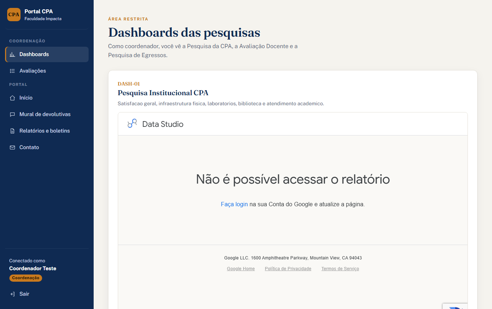

### Perfil 4 — Avaliador externo (MEC)

Vê **todos os dashboards ativos** em modo de leitura, para auditoria e avaliação regulatória. Os controles de edição e exclusão ficam ocultos.

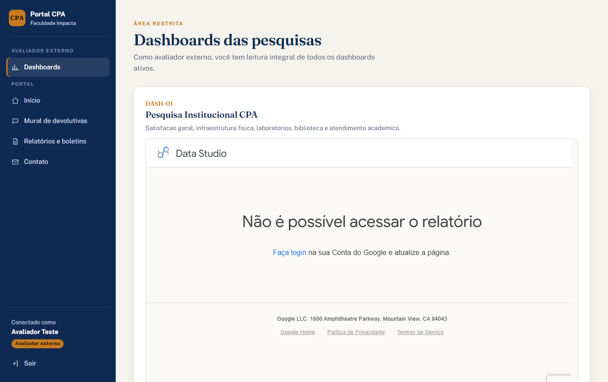

### Perfil 5 — Administrador (CPA)

Vê todos os dashboards e tem os formulários de gestão **nas próprias telas correspondentes**:

- **Dashboards:** cadastro, edição e remoção dos links do Looker Studio, com seleção dos perfis que podem ver cada painel.
- **Mural de devolutivas:** publicação, edição e exclusão de registros.
- **Relatórios e boletins:** upload e remoção de arquivos PDF.
- **Usuários:** cadastro de contas, troca de perfil, ativação e desativação.

| Dashboards (com gestão) | Usuários |
|---|---|
| 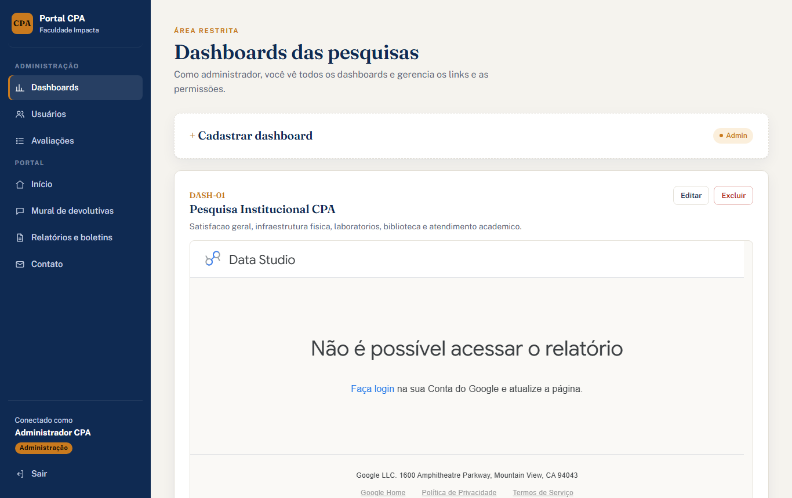 | 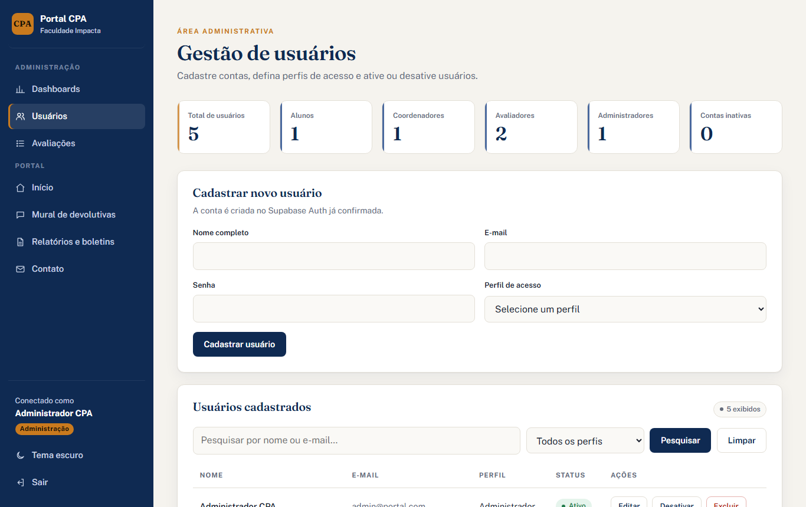 |

Quando um perfil tenta abrir uma página sem permissão, o portal mostra uma tela de acesso negado:

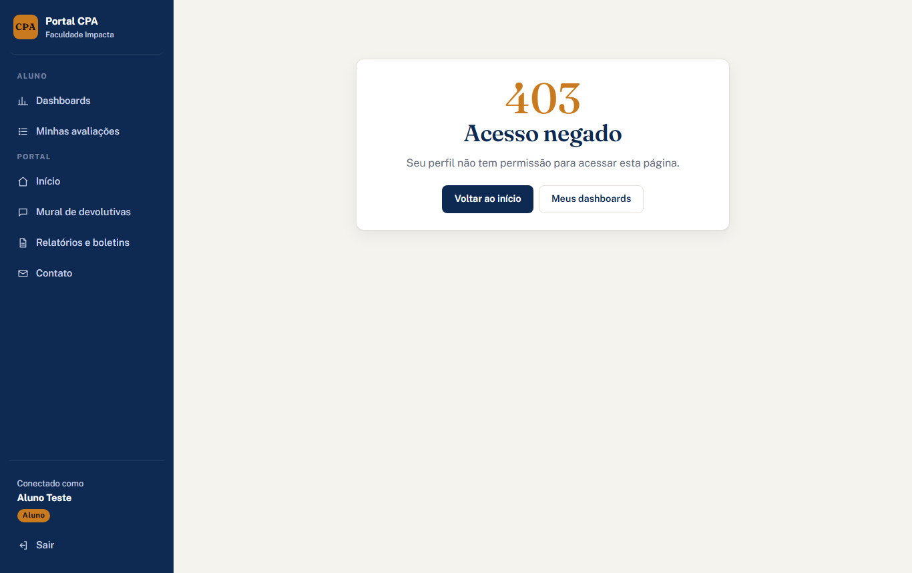
