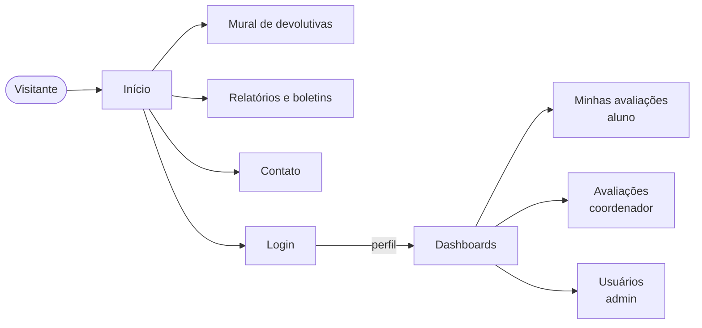

# Estrutura de Navegação e Arquitetura de Layout Responsivo

> **Projeto:** Portal Web da Comissão Própria de Avaliação (CPA) — Faculdade Impacta
> **Etapa:** Fase 2 — Modelagem e Design

| Integrante | Nome | RA |
|---|---|---|
| 1 | Monique Lima | 2503159 |
| 2 | Vitor Gabriel Ribeiro dos Santos | 2501307 |
| 3 | Alicya Sayuri Gallano Azato | 2500140 |

---

## 1. Arquitetura da informação e fluxo de navegação

A navegação segue a regra de acesso a qualquer conteúdo público em **no máximo 2 cliques** (RNF03). Na prática, todas as seções públicas ficam a **1 clique**, direto no menu. As áreas abertas ficam visualmente separadas da área restrita.

| Nível / seção | Página | Acesso exigido | Funcionalidades |
|---|---|---|---|
| Nível 1 (menu "Portal") | Início (`/`) | Público | Visão geral da CPA, indicadores e atalhos. |
| Nível 1 (menu "Portal") | Mural de devolutivas (`/devolutivas`) | Público (admin edita) | Consulta das respostas das áreas; publicação, edição e exclusão pelo admin. |
| Nível 1 (menu "Portal") | Relatórios e boletins (`/relatorios`) | Público (admin edita) | Abertura dos PDFs institucionais; upload e exclusão pelo admin. |
| Nível 1 (menu "Portal") | Contato (`/contato`) | Público | Botões para Google Chat, Google Meet e e-mail. |
| Nível 1 (ação do menu) | Login (`/login`) | Público | Autenticação por e-mail e senha. |
| Nível 2 (área restrita) | Dashboards (`/dashboards`) | Autenticado, por perfil | Painéis do Looker Studio conforme as permissões; gestão dos links pelo admin. |
| Nível 2 (área restrita) | Minhas avaliações (`/aluno/avaliacoes`) | Aluno | Ciclos de avaliação e seus períodos. |
| Nível 2 (área restrita) | Avaliações (`/coordenador`) | Coordenador e admin | Cadastro dos ciclos e indicador de participação. |
| Nível 2 (área restrita) | Usuários (`/admin`) | Admin | Cadastro, perfil, ativação e exclusão de contas. |

---

## 2. Padrão de navegação e componentes fixos

| Componente | Comportamento |
|---|---|
| **Menu lateral fixo** | Presente em todas as páginas, com a identidade da CPA no topo. Mostra primeiro a seção da área restrita do perfil (quando logado) e depois a seção "Portal" com as páginas públicas. O item da página atual fica destacado. |
| **Controle de sessão** | No rodapé do menu: botão **Entrar** quando deslogado; nome do usuário, etiqueta do perfil e botão **Sair** quando autenticado. |
| **Feedback visual** | Mensagens de alerta no topo do conteúdo confirmam as ações (login, publicação de devolutiva, envio de relatório) ou avisam de erros e bloqueios de acesso. |
| **Páginas de erro** | Acesso sem permissão mostra a tela "Acesso negado" (403); endereço inexistente mostra "Página não encontrada" (404). Ambas trazem botões de volta. |

> **Atualização:** a primeira versão previa uma barra de navegação superior horizontal. Na padronização do design, a equipe adotou o **menu lateral**, que comporta as duas seções (área restrita e portal) sem apertar os links, e vira uma barra superior com botão de menu no celular.

---

## 3. Especificação de layout responsivo

O layout usa estrutura fluida para garantir legibilidade e usabilidade em qualquer tela (RNF01):

| Dispositivo | Largura de tela | Adaptação da interface |
|---|---|---|
| Desktop / notebook | A partir de 960px | Menu lateral fixo; cards em grade de 2 a 4 colunas; dashboards em proporção widescreen (16:10 acima de 1100px). |
| Tablet | De 720px a 959px | Menu recolhido em botão (☰) que abre uma gaveta; grades de 2 colunas; dashboards em 4:3, sem rolagem lateral. |
| Smartphone | Abaixo de 720px | Cards empilhados em coluna única; tabelas viram lista de cartões; formulários em uma coluna; botões ampliados para toque; dashboards em formato vertical (3:4). |

---

## 4. Adaptação dos dashboards incorporados

Os painéis do Looker Studio (Google Data Studio) ficam dentro de contêineres responsivos: largura de 100% e altura definida por proporção (`aspect-ratio`), que muda conforme a largura da tela. Isso evita cortes nas visualizações em telas menores.
