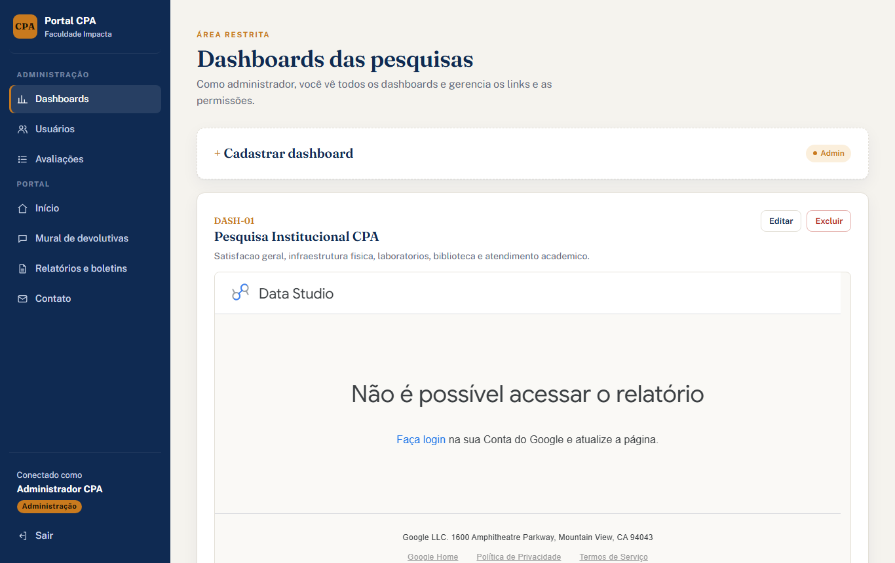

# Integração dos Dashboards do Google Data Studio por Perfil

> **Projeto:** Portal Web da Comissão Própria de Avaliação (CPA) — Faculdade Impacta
> **Etapa:** Fase 3 — Desenvolvimento do Portal

| Integrante | Nome | RA |
|---|---|---|
| 1 | Monique Lima | 2503159 |
| 2 | Vitor Gabriel Ribeiro dos Santos | 2501307 |
| 3 | Alicya Sayuri Gallano Azato | 2500140 |

---

## 1. Arquitetura de incorporação dinâmica

Para que os painéis criados no Google Data Studio (Looker Studio) sejam exibidos de forma centralizada e atualizados **sem intervenção no código-fonte**, a integração foi estruturada em três etapas:

| Etapa | Funcionamento |
|---|---|
| **1. Persistência no banco** | A tabela `dashboards` guarda o nome, a descrição, a URL de incorporação (`url_embed`), a ordem e se o painel está ativo. A tabela `dashboard_perfis` guarda quais perfis podem ver cada painel. |
| **2. Seleção no back-end** | Ao acessar `/dashboards` (`routes/dashboards.py`), o Flask consulta `Dashboard.visiveis_para()` com o perfil do usuário logado e envia ao template só a lista de painéis permitidos. |
| **3. Renderização segura (`<iframe>`)** | O template `dashboards.html` percorre a lista e incorpora cada painel em um `<iframe>` com carregamento sob demanda (`loading="lazy"`), opção de tela cheia e atributo `sandbox`, que limita o que o conteúdo incorporado pode fazer na página. |

> **Atualização:** a primeira versão previa a persistência no MySQL com as colunas `visivel_aluno`, `visivel_coordenador` e `visivel_avaliador`. Na versão adotada (Supabase/PostgreSQL), essas permissões ficam na tabela `dashboard_perfis`, e o avaliador MEC vê todos os painéis ativos por regra (RN03).

### Proteções do link

- O banco só aceita endereços de `lookerstudio.google.com` ou `datastudio.google.com` (restrição `CHECK`), e o formulário valida o mesmo antes de salvar.
- Se o admin colar o **link de compartilhamento** do relatório (`/reporting/...`), o portal converte para o **link de incorporação** (`/embed/reporting/...`).
- Para o painel abrir no portal, o relatório precisa estar com a incorporação habilitada no Looker Studio (*Arquivo → Incorporar relatório*) e compartilhado com quem vai vê-lo.

---

## 2. Matriz de exibição aplicada na integração

| Dashboard integrado | Aluno | Coordenador | Avaliador MEC | Admin CPA |
|---|:---:|:---:|:---:|:---:|
| **DASH-01** — Pesquisa Institucional CPA | Exibido | Exibido | Exibido | Exibido + gerenciar |
| **DASH-02** — Avaliação Docente por Curso | Oculto | Exibido | Exibido | Exibido + gerenciar |
| **DASH-03** — Acompanhamento de Egressos | Oculto | Exibido | Exibido | Exibido + gerenciar |

A matriz vem do `supabase/seed.sql` e pode ser alterada pelo admin a qualquer momento, sem deploy.

> Os três dashboards estão cadastrados com **links de demonstração**. Quando a CPA enviar os relatórios oficiais, o admin substitui as URLs pelo painel de gestão.

---

## 3. Painel de gestão de links (exclusivo do Admin CPA)

Na própria página `/dashboards`, o administrador vê um painel recolhível **"Cadastrar dashboard"** acima dos painéis, onde pode:

- cadastrar novos links de incorporação do Google Data Studio, com nome, descrição e ordem de exibição (o código `DASH-NN` é gerado automaticamente);
- definir quais perfis terão acesso, por caixas de seleção (Aluno e Coordenador; avaliador e admin já veem todos);
- **editar** um painel existente (trocar o link, os perfis ou ocultá-lo sem apagar);
- **remover** painéis desatualizados, com confirmação antes da exclusão.

