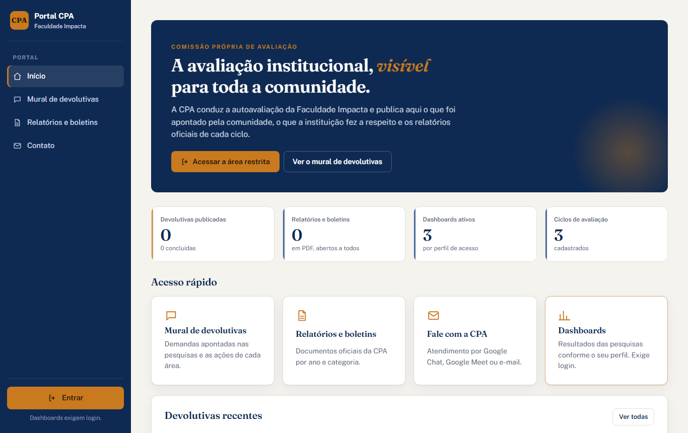
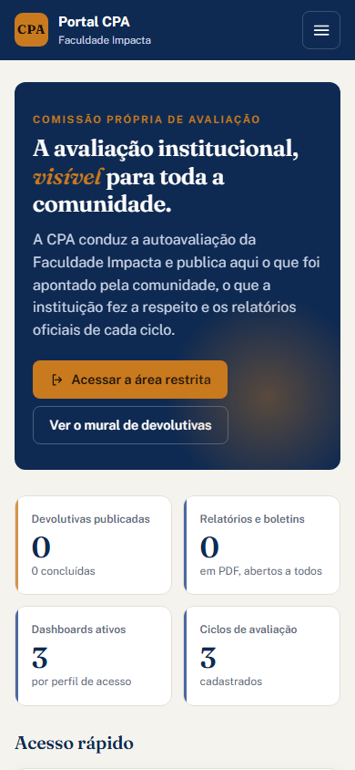
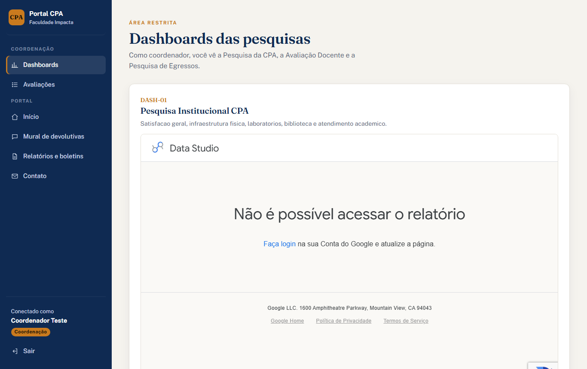
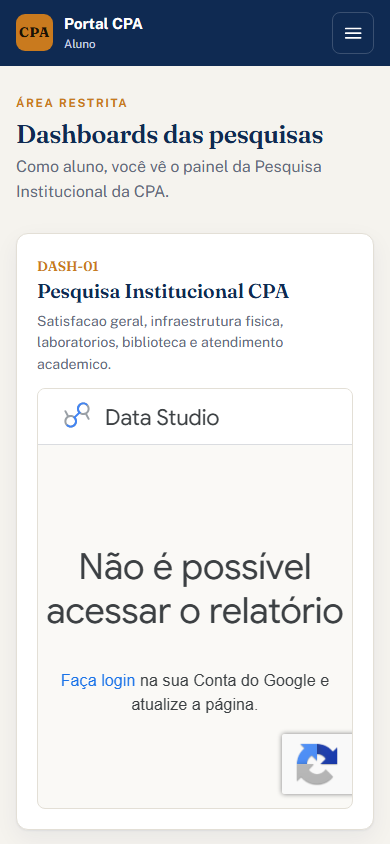

# Desenvolvimento da Página Inicial e Dashboards Dinâmicos e Responsivos

> **Projeto:** Portal Web da Comissão Própria de Avaliação (CPA) — Faculdade Impacta
> **Etapa:** Fase 3 — Desenvolvimento do Portal

| Integrante | Nome | RA |
|---|---|---|
| 1 | Monique Lima | 2503159 |
| 2 | Vitor Gabriel Ribeiro dos Santos | 2501307 |
| 3 | Alicya Sayuri Gallano Azato | 2500140 |

---

## 1. Estrutura da página inicial (`index.html`)

A página inicial (`/`) é a porta de entrada institucional da CPA para toda a comunidade acadêmica e abre **sem login** (RN01). Ela reúne:

| Bloco | Conteúdo |
|---|---|
| **Cabeçalho institucional** | Apresentação do papel da Comissão Própria de Avaliação na melhoria contínua da Faculdade Impacta, com botões para o mural e para a área restrita. |
| **Indicadores de transparência** | Contadores atualizados pelo banco: devolutivas publicadas, ações concluídas, relatórios e boletins disponíveis, dashboards ativos e ciclos de avaliação cadastrados. |
| **Cartões de acesso rápido** | Atalhos para as seções públicas (Mural de devolutivas, Relatórios e boletins em PDF, Contato) e cartão de destaque para a área restrita (Dashboards). |
| **Últimas devolutivas** | As três devolutivas mais recentes do mural, com status, e link para ver todas. |

| Computador | Celular |
|---|---|
|  |  |

---

## 2. Renderização dinâmica e responsiva dos dashboards (`dashboards.html`)

Na área logada, a exibição dos painéis se adapta tanto ao **perfil do usuário** quanto ao **tamanho da tela**:

| Recurso | Funcionamento |
|---|---|
| **Renderização dinâmica** | A página mostra exatamente os painéis que o banco retorna para o perfil, na ordem cadastrada. Se nenhum dashboard estiver liberado, exibe uma mensagem informativa no lugar dos painéis. |
| **Contêineres responsivos** | Cada painel fica em um contêiner fluido (`width: 100%`) com altura proporcional por `aspect-ratio`, ajustada por *media queries*: 3:4 no celular, 4:3 no tablet e 16:10 em telas largas. Isso evita cortes horizontais e distorções. |
| **Navegação adaptativa** | Abaixo de 960px, o menu lateral vira uma barra superior com botão (☰) que abre o menu em gaveta, mantendo visíveis o nome do usuário, o perfil e o botão de saída. |

> **Atualização:** a primeira versão citava o retorno do "banco de dados MySQL" e uma barra superior que vira menu retrátil. Na versão adotada, os dados vêm do PostgreSQL do Supabase e a navegação usa menu lateral, que se recolhe em telas menores (ver [estrutura de navegação](../fase-2-modelagem/03-estrutura-de-navegacao.md)).

| Coordenador (computador) | Aluno (celular) |
|---|---|
|  |  |
