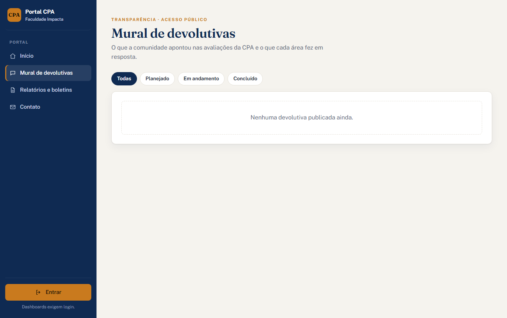

# Mural de Devolutivas com Área Administrativa

> **Projeto:** Portal Web da Comissão Própria de Avaliação (CPA) — Faculdade Impacta
> **Etapa:** Fase 4 — Funcionalidades Complementares
> **Requisitos:** RF05, RF06, RN01

| Integrante | Nome | RA |
|---|---|---|
| 1 | Monique Lima | 2503159 |
| 2 | Vitor Gabriel Ribeiro dos Santos | 2501307 |
| 3 | Alicya Sayuri Gallano Azato | 2500140 |

---

## 1. Objetivo

Dar transparência às respostas da instituição para as demandas levantadas nas pesquisas da CPA, mostrando à comunidade acadêmica **o que foi apontado, quem é responsável e o que foi feito**.

---

## 2. Página pública (`/devolutivas`)

Aberta a qualquer visitante, **sem login** (RN01).

| Elemento | Funcionamento |
|---|---|
| **Cards de devolutiva** | Cada card mostra a demanda identificada, a área responsável, a ação da instituição, a data de publicação e uma etiqueta colorida de status. |
| **Status** | *Planejado*, *Em andamento* ou *Concluído*, com cores diferentes para leitura rápida. |
| **Filtro** | Botões no topo filtram o mural por status. |
| **Ordem** | Da publicação mais recente para a mais antiga. |
| **Destaque na página inicial** | As três devolutivas mais recentes também aparecem na página inicial. |

---

## 3. Área administrativa (perfil Admin CPA)

A gestão fica **na própria página do mural**, visível só para o administrador:

| Ação | Como funciona |
|---|---|
| **Publicar** | Painel recolhível "Publicar devolutiva" com demanda, área responsável, ação, status e data (o dia atual vem preenchido). |
| **Editar** | Botão em cada card abre o formulário com os dados atuais, por exemplo para mudar o status de *Em andamento* para *Concluído*. |
| **Excluir** | Botão em cada card, com confirmação antes de apagar. |

Todas as rotas de escrita exigem o perfil admin (`@exige_perfil("admin")`) e um token CSRF. Os dados ficam na tabela `devolutivas` (ver [modelagem do banco](../fase-2-modelagem/01-modelagem-banco-de-dados.md)).

---

## 4. Implementação

| Arquivo | Conteúdo |
|---|---|
| `routes/publico.py` | Rotas `devolutivas`, `criar_devolutiva`, `editar_devolutiva` e `excluir_devolutiva` |
| `templates/devolutivas.html` | Página do mural e painel de publicação |
| `templates/devolutiva_form.html` | Formulário de edição |
| `templates/_devolutiva_campos.html` | Campos compartilhados entre publicação e edição |
