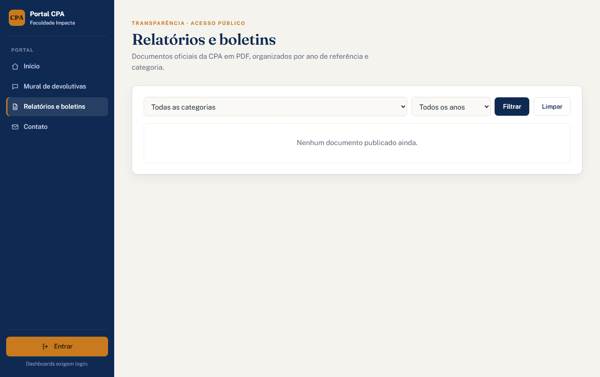

# Área de Relatórios e Boletins

> **Projeto:** Portal Web da Comissão Própria de Avaliação (CPA) — Faculdade Impacta
> **Etapa:** Fase 4 — Funcionalidades Complementares
> **Requisitos:** RF07, RF08, RN01, RN04

| Integrante | Nome | RA |
|---|---|---|
| 1 | Monique Lima | 2503159 |
| 2 | Vitor Gabriel Ribeiro dos Santos | 2501307 |
| 3 | Alicya Sayuri Gallano Azato | 2500140 |

---

## 1. Objetivo

Reunir em um repositório público os documentos oficiais da CPA, como o **Relatório de Autoavaliação Institucional** (DOC-01) e os **Boletins Informativos** (DOC-02), para consulta da comunidade e dos avaliadores do MEC.

---

## 2. Página pública (`/relatorios`)

Aberta a qualquer visitante, **sem login** (RN01).

| Elemento | Funcionamento |
|---|---|
| **Lista de documentos** | Título, categoria, ano de referência e descrição de cada PDF. |
| **Filtros** | Por categoria (Relatório de Autoavaliação ou Boletim Informativo) e por ano de referência. |
| **Download** | O botão "Abrir PDF" abre o arquivo em nova aba, direto do Supabase Storage. |

---

## 3. Upload pelo administrador

Na própria página, o admin vê o painel recolhível **"Enviar documento"** com título, categoria, ano, descrição opcional e o arquivo.

| Regra | Como é garantida |
|---|---|
| **Somente PDF (RN04)** | Conferido no navegador (extensão e assinatura `%PDF`), no Flask (assinatura `%PDF` do arquivo salvo) e no bucket, que só aceita `application/pdf`. |
| **Até 20 MB** | Limite do bucket `documentos`, conferido também no navegador. |
| **Arquivos grandes na Vercel** | A Vercel aceita no máximo cerca de 4,5 MB por requisição. Por isso o navegador envia o PDF **direto ao Storage**, com uma URL de uso único que o Flask gera só para o admin. Depois, o formulário envia apenas os dados do documento. |
| **Arquivo inválido** | Se o arquivo enviado não for um PDF, o Flask apaga o arquivo do Storage e não cadastra o documento. |
| **Exclusão** | O botão "Excluir" remove a linha do banco e o arquivo do Storage, com confirmação. |

Sem JavaScript, o formulário continua funcionando pelo envio tradicional, sujeito ao limite da hospedagem.

---

## 4. Implementação

| Arquivo | Conteúdo |
|---|---|
| `routes/publico.py` | Rotas `relatorios`, `assinar_envio`, `enviar_documento` e `excluir_documento` |
| `templates/relatorios.html` | Página pública, painel de envio e script do envio direto |
| Tabela `documentos` e bucket `documentos` | Ver [modelagem do banco](../fase-2-modelagem/01-modelagem-banco-de-dados.md) |
