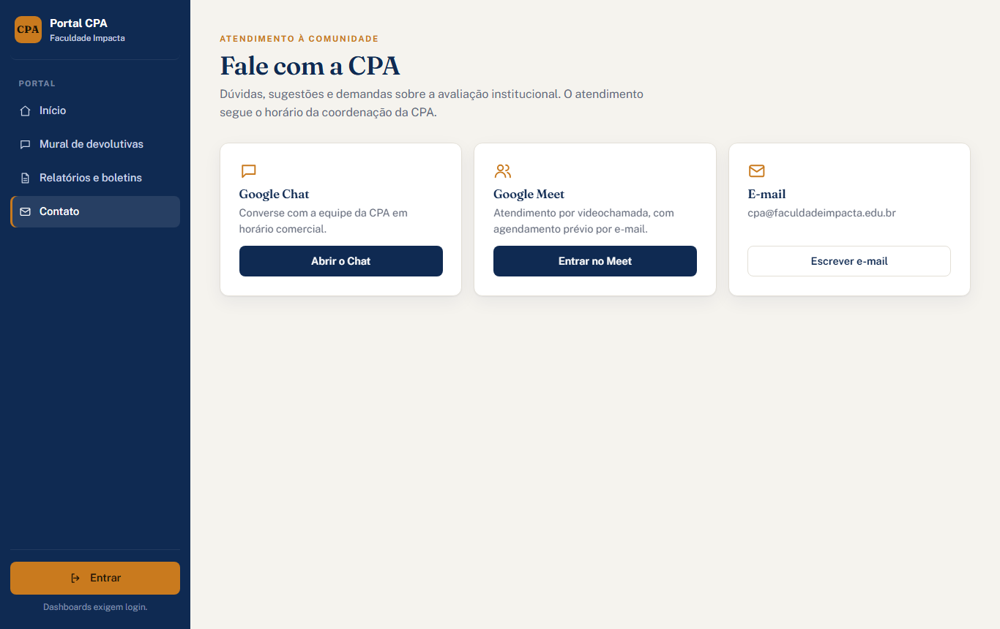

# Página de Contato com Google Chat e Google Meet

> **Projeto:** Portal Web da Comissão Própria de Avaliação (CPA) — Faculdade Impacta
> **Etapa:** Fase 4 — Funcionalidades Complementares
> **Requisitos:** RF09, RN01

| Integrante | Nome | RA |
|---|---|---|
| 1 | Monique Lima | 2503159 |
| 2 | Vitor Gabriel Ribeiro dos Santos | 2501307 |
| 3 | Alicya Sayuri Gallano Azato | 2500140 |

---

## 1. Objetivo

Oferecer à comunidade acadêmica canais diretos de atendimento da CPA, **sem login** (RN01).

---

## 2. Página `/contato`

| Canal | Botão | Uso |
|---|---|---|
| **Google Chat** | Abre a conversa ou o espaço da CPA no Google Chat | Dúvidas rápidas |
| **Google Meet** | Abre a sala de atendimento da CPA no Google Meet | Atendimento por vídeo |
| **E-mail** | Abre o programa de e-mail com o endereço da CPA preenchido | Solicitações formais |

---

## 3. Configuração dos links

Os endereços **não ficam no código**: são lidos de variáveis de ambiente, então podem ser trocados sem alterar nenhum arquivo do projeto.

| Variável | Conteúdo | Valor padrão, se não definida |
|---|---|---|
| `CPA_LINK_CHAT` | Link do espaço da CPA no Google Chat | `https://chat.google.com/` |
| `CPA_LINK_MEET` | Link da sala fixa da CPA no Google Meet | `https://meet.google.com/` |
| `CPA_EMAIL` | E-mail de atendimento | `cpa@faculdadeimpacta.edu.br` |

Em produção, as variáveis são definidas no painel da Vercel (*Settings → Environment Variables*) e passam a valer no próximo deploy (*Deployments → Redeploy*). Localmente, ficam no arquivo `.env`.

---

## 4. Implementação

| Arquivo | Conteúdo |
|---|---|
| `routes/publico.py` | Rota `contato`, que lê as variáveis de ambiente |
| `templates/contato.html` | Página com os três cartões de contato |
